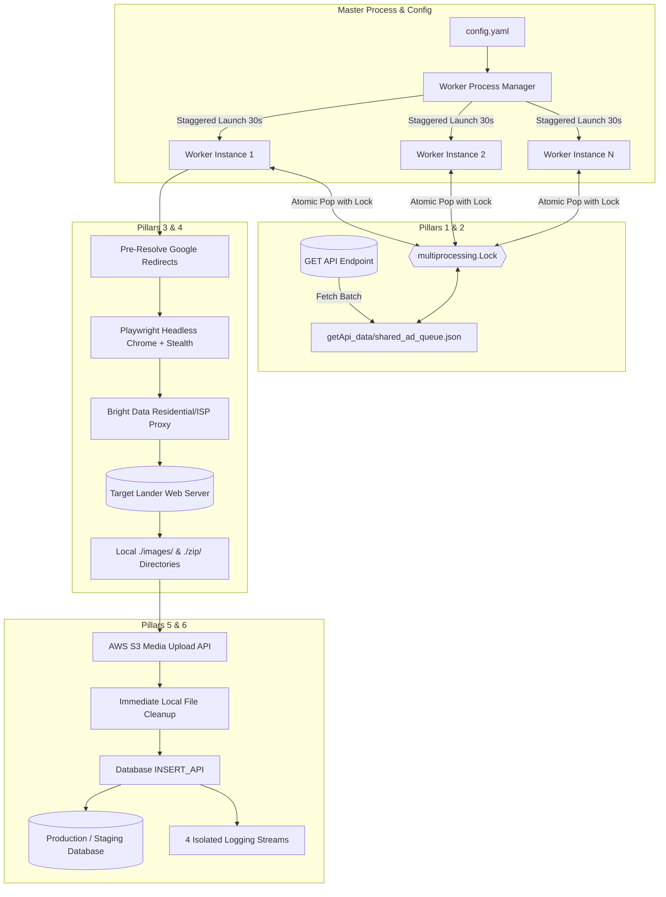

# PowerAdSpy Lander Archiver (`PowerAdSpy_lander`)

A high-throughput, fault-tolerant landing page crawling, archiving, and intelligence engine built for production Linux/Docker containers and Windows environments. Powered by **Python Playwright (Sync API)**, headless Google Chrome, and **Bright Data Residential/ISP Superproxy Infrastructure**, this system autonomously ingests ad metadata across major advertising networks (**Facebook, Instagram, Google, YouTube, Native, Pinterest, etc.**), evades enterprise anti-bot defenses, classifies content versus authentication checkpoints, captures full-page progressive screenshots and HTML archives, and syncs assets to AWS S3 and database backends.

---

## Table of Contents

1. [Executive Architecture Overview](#1-executive-architecture-overview)
2. [Master End-to-End Logic Diagram (The 6 Core Pillars)](#2-master-end-to-end-logic-diagram-the-6-core-pillars)
3. [The 6 Core System Pillars Explained](#3-the-6-core-system-pillars-explained)
   - [Pillar 1: How Ads Are Ingested & Stored](#pillar-1-how-ads-are-ingested--stored)
   - [Pillar 2: Multi-Worker Concurrent Processing & Locking](#pillar-2-multi-worker-concurrent-processing--locking)
   - [Pillar 3: Ephemeral & Persistent File Management](#pillar-3-ephemeral--persistent-file-management)
   - [Pillar 4: Comprehensive Error Handling & Triage](#pillar-4-comprehensive-error-handling--triage)
   - [Pillar 5: Handling Successful (Status 2) vs Unsuccessful (Status 3) Data](#pillar-5-handling-successful-status-2-vs-unsuccessful-status-3-data)
   - [Pillar 6: Delivering Data to the Database Through Insert API](#pillar-6-delivering-data-to-the-database-through-insert-api)
4. [Decision Matrix: Status 2 vs Status 3](#4-decision-matrix-status-2-vs-status-3)
5. [Network-Specific Routing & Endpoint Mapping](#5-network-specific-routing--endpoint-mapping)
6. [Logging Streams & Audit Infrastructure](#6-logging-streams--audit-infrastructure)
7. [Health & Integrity Analysis (`analysis.py`)](#7-health--integrity-analysis-analysispy)
8. [Configuration Guide (`config.yaml`)](#8-configuration-guide-configyaml)
9. [Deployment & Operations Guide](#9-deployment--operations-guide)
10. [Scratch Regression Test Suite (`scratch/`)](#10-scratch-regression-test-suite-scratch)

---

## 1. Executive Architecture Overview

The system operates as a distributed multi-worker engine that coordinates between remote ingestion APIs, shared disk queues, Playwright browser instances, Bright Data proxies, AWS S3 storage, and PostgreSQL/MySQL database endpoints.



---

## 2. Master End-to-End Logic Diagram (The 6 Core Pillars)

Below is the complete, self-contained architecture and execution logic illustrating **all 6 required core mechanisms**. 

Because this `README.md` is designed to be shared as a **100% standalone document** without requiring external image assets or special plugins, the complete logic flow is drawn directly in **pure Markdown code**:

1. **Universal Architecture Flowchart (Pure Text/Code)**: Renders identically in any text editor, standard markdown preview, terminal, email, or IDE without needing image files.
2. **Interactive Mermaid Flowchart**: For platforms with built-in Mermaid diagramming engines (such as GitHub, GitLab, Notion, Obsidian, and Mermaid-enabled IDEs).

---

### A. Universal Text & Box Architecture Flowchart
*(Rendered directly in Markdown -- 100% self-contained, zero external files or image paths)*

```text
+==================================================================================================+
|                        MASTER ARCHITECTURE FLOWCHART (THE 6 CORE PILLARS)                        |
+==================================================================================================+

+--------------------------------------------------------------------------------------------------+
| PILLAR 1: HOW ADS ARE STORED & QUEUED                                                            |
+--------------------------------------------------------------------------------------------------+
                                               |
                                  [ Worker Needs Next Ad ]
                                               |
                                               v
                              +----------------------------------+
                              | shared_ad_queue.json exists and  |
                              | has available ad objects?        |
                              +----------------+-----------------+
                                               |
                         NO (Queue Empty)      |      YES (Ads in Queue)
             +---------------------------------+-----------------+
             |                                                   |
             v                                                   v
+-------------------------------+                  +-------------------------------+
| Acquire multiprocessing.Lock  |                  | Proceed directly to           |
+------------+------------------+                  | Atomic Pop in Pillar 2        |
             |                                     +-------------+-----------------+
             v                                                   |
+-------------------------------+                                |
| Check config.yaml:            |                                |
| HIT_GET_API == true?          |                                |
+------------+------------------+                                |
             |                                                   |
     YES     |     NO                                            |
   +---------+---------+                                         |
   v                   v                                         |
+-----------------+ +-----------------+                          |
| Call Remote API | | Read Local File |                          |
| (getAdwith-     | | getApi_data/    |                          |
|  CountryCode)   | | getdata.json    |                          |
+--------+--------+ +--------+--------+                          |
         |                   |                                   |
         +---------+---------+                                   |
                   v                                             |
+-------------------------------------+                          |
| Atomically write full array to disk:|                          |
| getApi_data/shared_ad_queue.json    |                          |
+------------------+------------------+                          |
                   |                                             |
                   v                                             |
+-------------------------------------+                          |
| Release multiprocessing.Lock        |                          |
+------------------+------------------+                          |
                   |                                             |
                   +----------------------+----------------------+
                                          |
                                          v
+--------------------------------------------------------------------------------------------------+
| PILLAR 2: MULTI-WORKER PROCESSING & CONCURRENCY LOCKING                                          |
+--------------------------------------------------------------------------------------------------+
                                          |
                               [ Worker Instance 1..N ]
                                          |
                                          v
                         +---------------------------------+
                         |  Acquire multiprocessing.Lock   |
                         +----------------+----------------+
                                          |
                                          v
                         +---------------------------------+
                         | Read shared_ad_queue.json       |
                         +----------------+----------------+
                                          |
                                          v
                         +---------------------------------+
                         | ATOMIC POP: ad = queue.pop(0)   |
                         | Save remaining queue back to    |
                         | shared_ad_queue.json on disk    |
                         +----------------+----------------+
                                          |
                                          v
                         +---------------------------------+
                         |  Release multiprocessing.Lock   |
                         +----------------+----------------+
                                          |
                                          v
                         +---------------------------------+
                         |       Popped Ad is Valid?       |
                         +----------------+----------------+
                                          |
                      NO                  |                  YES
          +-------------------------------+-------------------------------+
          v                                                               v
+-------------------------------+                       +-----------------------------------+
| Sleep 5s Exponential Backoff  |                       | Spawn scraping single_data        |
| & Loop back to Pillar 1       |                       | Isolated Process + Dedicated Port |
+--------------+----------------+                       +-----------------+-----------------+
               |                                                          |
               +----------------------+                                   |
                                      v                                   v
+--------------------------------------------------------------------------------------------------+
| PRE-NAVIGATION: GOOGLE SERP REDIRECT RESOLUTION & PROXY BYPASS                                   |
+--------------------------------------------------------------------------------------------------+
                                                                          |
                                                                          v
                                                         +----------------------------------+
                                                         | URL is Google Ad Redirector?     |
                                                         | (google.com/goto, googleadserv..)|
                                                         +----------------+-----------------+
                                                                          |
                                                    YES                   |                   NO
                                 +----------------------------------------+-------------------+
                                 v                                                            v
                 +-------------------------------+                          +-------------------------------+
                 | Direct Unproxied HTTP HEAD/GET|                          | Keep Destination URL as-is    |
                 | (Bypasses Bright Data 403)    |                          | nav_url = destination_url     |
                 +---------------+---------------+                          +---------------+---------------+
                                 |                                                          |
                                 v                                                          |
                 +-------------------------------+                                          |
                 | HTTP 302 Found with Location? |                                          |
                 +---------------+---------------+                                          |
                                 |                                                          |
                      YES        |        NO                                                |
             +-------------------+-------------------+                                      |
             v                                       v                                      |
+-------------------------------+ +-------------------------------+                         |
| Set nav_url = Target Location | | Keep original destination_url |                         |
| Store Google URL in redirects | +--------------+----------------+                         |
+------------+------------------+                |                                          |
             |                                   |                                          |
             +-------------------+---------------+                                          |
                                 |                                                          |
                                 +--------------------------+-------------------------------+
                                                            |
                                                            v
+--------------------------------------------------------------------------------------------------+
| PILLAR 4: COMPREHENSIVE ERROR HANDLING & TRIAGE                                                  |
+--------------------------------------------------------------------------------------------------+
                                                            |
                                                            v
                                           +----------------------------------+
                                           | Navigate page.goto (Timeout 90s) |
                                           +----------------+-----------------+
                                                            |
                                                            v
                                           +----------------------------------+
                                           | Navigation Error encountered?    |
                                           | (Timeout, Tunnel Fail, DNS Drop) |
                                           +----------------+-----------------+
                                                            |
                                       YES                  |                  NO
                    +---------------------------------------+------------------+
                    v                                                          v
+---------------------------------------+                    +----------------------------------+
| Log error to unsuccessful_ads.json:   |                    | Inspect DOM & Document Title:    |
| reason: Navigation / Timeout Error    |                    | (check_page_status)              |
+-------------------+-------------------+                    +-----------------+----------------+
                    |                                                          |
                    |                                                          v
                    |                                        +----------------------------------+
                    |                                        | Dead Page, 404/502, or WAF Block?|
                    |                                        | (Cloudflare, Account Suspended)  |
                    |                                        +-----------------+----------------+
                    |                                                          |
                    |                                      YES                 |                 NO
                    |                        +---------------------------------+-----------------+
                    |                        v                                                   v
                    |       +---------------------------------+                 +----------------------------------+
                    |       | Log to unsuccessful_ads.json:   |                 | Extracted HTML text content is   |
                    |       | reason: WAF / Page Error        |                 | empty or < 10 characters?        |
                    |       +----------------+----------------+                 +----------------+-----------------+
                    |                        |                                                   |
                    |                        |                                 YES               |               NO
                    |                        |                    +------------------------------+---------------+
                    |                        |                    v                                              v
                    |                        |       +-------------------------------+      +-----------------------------+
                    |                        |       | Log to unsuccessful_ads.json: |      | Page Content Valid!         |
                    |                        |       | reason: Empty HTML content    |      | Proceed to File Management  |
                    |                        |       +---------------+---------------+      +--------------+--------------+
                    |                        |                       |                                     |
                    v                        v                       v                                     |
          +---------------------------------------------------------------------+                          |
          |                   TRIGGER MINIMAL STATUS 3 INSERTION                |                          |
          |              (No screenshot, no HTML DOM, minimal payload)          |                          |
          +----------------------------------+----------------------------------+                          |
                                             |                                                             |
                                             | <-----------------------------------------------------------+
                                             |
                                             v
+--------------------------------------------------------------------------------------------------+
| PILLAR 3: EPHEMERAL & PERSISTENT FILE MANAGEMENT                                                 |
+--------------------------------------------------------------------------------------------------+
                                             |
                                             v
                          +--------------------------------------+
                          | Create Isolated Local Directories:   |
                          |   ./images/{instance_no}/            |
                          |   ./zip/{instance_no}/               |
                          +------------------+-------------------+
                                             |
                                             v
                          +--------------------------------------+
                          | Capture Full Page Screenshot:        |
                          |   ./images/{instance_no}/img.jpg     |
                          |   (Progressive JPEG compressed < 1MB)|
                          +------------------+-------------------+
                                             |
                                             v
                          +--------------------------------------+
                          | Package Full DOM & Assets into ZIP:  |
                          |   ./zip/{instance_no}/lander.zip     |
                          +------------------+-------------------+
                                             |
                                             v
                          +--------------------------------------+
                          | Write Thread-Safe Persistent Logs:   |
                          |   - payloads.log                     |
                          |   - successful_payloads.json         |
                          |   - unsuccessful_ads.json            |
                          |   - proxy.log                        |
                          +------------------+-------------------+
                                             |
                                             v
+--------------------------------------------------------------------------------------------------+
| PILLAR 5: SUCCESSFUL (STATUS 2) vs UNSUCCESSFUL / LOGIN GATE (STATUS 3)                          |
+--------------------------------------------------------------------------------------------------+
                                             |
                                             v
                          +--------------------------------------+
                          | Evaluate Page Content:               |
                          | is_login_or_signup_page() &          |
                          | status_3_keywords.txt verification   |
                          +------------------+-------------------+
                                             |
            +--------------------------------+--------------------------------+
            |                                                                 |
    [ ACTIVE STORE / BLOG / LANDER ]                                  [ AUTH WALL / LOGIN GATE ]
    (Word count > 200 words,                                          (Redirected to login/signup,
     normal e-commerce or landing page)                                social auth wall, sparse page)
            |                                                                 |
            v                                                                 v
+---------------------------------------+         +---------------------------------------------------------+
| CLASSIFIED AS: STATUS 2 (SUCCESS)     |         | CLASSIFIED AS: STATUS 3 (SCRAPED LOGIN GATE)            |
+---------------------------------------+         +---------------------------------------------------------+
| 1. Upload ./images/{i}/img.jpg to S3  |         | 1. Upload Screenshot to S3 (status=2 to S3 to get URL)  |
|    (status=2 -> returns public URL)   |         | 2. Build Status 3 Payload:                              |
| 2. Build Status 2 Payload:            |         |    - ad_id, destinations, status: 3                     |
|    - ad_id, destinations, status: 2   |         |    - screen_shot: S3 URL, reason: Login Gate            |
|    - screen_shot: S3 URL              |         | 3. Log [SCRAPED PAYLOAD status=3] to payloads.log       |
|    - html_content, domain_age, etc.   |         |    and save to logs/unsuccessful_ads.json               |
| 3. Log [SUCCESSFUL PAYLOAD status=2]  |         +----------------------------+----------------------------+
|    to payloads.log and save full      |                                      |
|    body to successful_payloads.json   |                                      |
+-------------------+-------------------+                                      |
                    |                                                          |
                    +----------------------------------+-----------------------+
                                                       |
                                                       v
+--------------------------------------------------------------------------------------------------+
| PILLAR 6: DATABASE DELIVERY VIA INSERT API & EPHEMERAL CLEANUP                                   |
+--------------------------------------------------------------------------------------------------+
                                                       |
                                                       v
                                    +-------------------------------------+
                                    | Resolve API Endpoint (config.yaml): |
                                    | DEV:  stagingtest-api.poweradspy... |
                                    | PROD: api.poweradspy.com/...        |
                                    +------------------+------------------+
                                                       |
                                                       v
                                    +-------------------------------------+
                                    | Construct JSON Request Body:        |
                                    | {'ad_id': ad_id, 'insertData': ...} |
                                    | Log [INSERT API REQUEST] payloads   |
                                    +------------------+------------------+
                                                       |
                                                       v
                                    +-------------------------------------+
                                    | POST requests.post(url, timeout=60s)|
                                    +------------------+------------------+
                                                       |
                                                       v
                                    +-------------------------------------+
                                    | Response HTTP 200 & Body code 200?  |
                                    +------------------+------------------+
                                                       |
                                   YES                 |                 NO
                     +---------------------------------+-----------------+
                     v                                                   v
+-----------------------------------------+             +-----------------------------------------+
| Log [INSERT API RESPONSE] with Latency  |             | Log insertion error to error_logger     |
| Increment Prometheus: updated_lander    |             | Increment Prometheus insertion errors   |
| Attach _result_status to Ad object      |             |                                         |
+--------------------+--------------------+             +--------------------+--------------------+
                     |                                                       |
                     +-------------------------+-----------------------------+
                                               |
                                               v
                              +-----------------------------------+
                              | FINALLY BLOCK: EPHEMERAL CLEANUP  |
                              | shutil.rmtree('./images/{i}')     |
                              | shutil.rmtree('./zip/{i}')        |
                              | (Guarantees ZERO disk space leak) |
                              +----------------+------------------+
                                               |
                                               v
                              +-----------------------------------+
                              | Ad Cycle Complete -> Next Worker  |
                              | Loop back to Pillar 1             |
                              +-----------------------------------+
```

---

### B. Interactive Mermaid Flowchart
*(Renders dynamically into graphic vectors when viewed on GitHub or inside Mermaid-enabled Markdown viewers)*

```mermaid
flowchart TD
    %% ==========================================
    %% PILLAR 1: HOW ADS ARE STORED & QUEUED
    %% ==========================================
    subgraph P1 ["1. HOW ADS ARE STORED & QUEUED"]
        direction TB
        P1_START(["Worker Needs Next Ad"]) --> P1_CHECK_QUEUE{"shared_ad_queue.json exists and has ads?"}
        P1_CHECK_QUEUE -- "No: Queue Empty" --> P1_ACQ_LOCK["Acquire multiprocessing.Lock"]
        P1_ACQ_LOCK --> P1_CHECK_SRC{"HIT_GET_API enabled in config.yaml?"}
        P1_CHECK_SRC -- "Yes: Live API" --> P1_CALL_API["Call Remote GET_API: getAdwithCountryCode / get_gtext_ads"]
        P1_CHECK_SRC -- "No: Local Cache" --> P1_READ_LOCAL["Read getApi_data/getdata.json"]
        P1_CALL_API --> P1_WRITE_DISK["Save Ingested Ads Array to getApi_data/shared_ad_queue.json"]
        P1_READ_LOCAL --> P1_WRITE_DISK
        P1_WRITE_DISK --> P1_REL_LOCK["Release multiprocessing.Lock"]
        P1_REL_LOCK --> P1_POP
        P1_CHECK_QUEUE -- "Yes: Ads Available" --> P1_POP["Proceed to Atomic Pop"]
    end

    %% ===================================================
    %% PILLAR 2: MULTI-WORKER PROCESSING & LOCKING
    %% ===================================================
    subgraph P2 ["2. MULTI-WORKER CONCURRENCY & LOCKING"]
        direction TB
        P2_ENTRY(["Worker Instance 1..N"]) --> P2_LOCK["Acquire multiprocessing.Lock"]
        P2_LOCK --> P2_READ_DISK["Read getApi_data/shared_ad_queue.json"]
        P2_ATOMIC_POP["Atomically pop ad at index 0: ad = queue.pop(0)"]
        P2_READ_DISK --> P2_ATOMIC_POP
        P2_ATOMIC_POP --> P2_SAVE_REMAINING["Write remaining queue back to disk"]
        P2_SAVE_REMAINING --> P2_UNLOCK["Release multiprocessing.Lock"]
        P2_UNLOCK --> P2_CHECK_EMPTY{"Popped Ad Valid?"}
        P2_CHECK_EMPTY -- "No: Queue was empty" --> P2_BACKOFF["Sleep 5s Backoff"] --> P1_START
        P2_CHECK_EMPTY -- "Yes: Valid Ad Object" --> P2_SPAWN_TASK["Execute scraping single_data: Isolated Process & Prometheus Port"]
    end

    P1_POP --> P2_ENTRY

    %% ===================================================
    %% PRE-NAVIGATION & RESOLUTION
    %% ===================================================
    subgraph PRE_NAV ["PRE-NAVIGATION & SERP PROXY BYPASS"]
        direction TB
        P2_SPAWN_TASK --> CHECK_GOOGLE_WRAPPER{"URL is Google Ad Redirector? (google.com/goto, googleadservices.com)"}
        CHECK_GOOGLE_WRAPPER -- "Yes" --> RESOLVE_GOOGLE["Execute Direct Unproxied HTTP Request (Bypasses Bright Data 403 Forbidden serp domain)"]
        RESOLVE_GOOGLE --> GOT_LOCATION{"HTTP 302 with Location?"}
        GOT_LOCATION -- "Yes" --> USE_RESOLVED["Set nav_url = Target Location, Store Google URL in ret_redirects"]
        GOT_LOCATION -- "No" --> USE_DIRECT["Keep destination_url as nav_url"]
        CHECK_GOOGLE_WRAPPER -- "No" --> USE_DIRECT
    end

    %% ===================================================
    %% PILLAR 3: EPHEMERAL & PERSISTENT FILE MANAGEMENT
    %% ===================================================
    subgraph P3 ["3. EPHEMERAL & PERSISTENT FILE MANAGEMENT"]
        direction TB
        P3_CREATE_DIRS["Create Isolated Instance Directories: ./images/instance_no/ and ./zip/instance_no/"]
        P3_CREATE_DIRS --> P3_CAPTURE_SHOT["Capture Full-Page Screenshot: ./images/instance_no/img.jpg (Progressive JPEG < 1.0 MB)"]
        P3_CAPTURE_SHOT --> P3_ZIP_DOM["Package Full DOM into ZIP: ./zip/instance_no/lander.zip"]
        P3_ZIP_DOM --> P3_PERSIST_LOGS["Write to Persistent Logs: payloads.log, successful_payloads.json, unsuccessful_ads.json, proxy.log"]
        P3_PERSIST_LOGS --> P3_CLEANUP["Immediate Cleanup in finally Block: shutil.rmtree ./images/ and ./zip/ (Zero Disk Leaks)"]
    end

    %% ===================================================
    %% PILLAR 4: COMPREHENSIVE ERROR HANDLING
    %% ===================================================
    subgraph P4 ["4. COMPREHENSIVE ERROR HANDLING & TRIAGE"]
        direction TB
        P4_NAV["Navigate page.goto nav_url, timeout=90s"] --> P4_ERR_NAV{"Navigation Error? (Timeout, ERR_TUNNEL, Net Unreachable)"}
        P4_ERR_NAV -- "Yes" --> P4_LOG_NAV_ERR["Set reason = Timeout or Connection Error, Log to logs/unsuccessful_ads.json"]
        P4_LOG_NAV_ERR --> P4_SEND_ERR_S3["Trigger Minimal Status 3 Insertion"]

        P4_ERR_NAV -- "No" --> P4_CHECK_PAGE["check_page_status: Inspect DOM & Title"]
        P4_CHECK_PAGE --> P4_IS_DEAD{"Dead Page or WAF Challenge? (Cloudflare, 404, 403, 502, Account Suspended)"}
        P4_IS_DEAD -- "Yes" --> P4_LOG_DEAD["Set reason = WAF / Error status, Log to logs/unsuccessful_ads.json"]
        P4_LOG_DEAD --> P4_SEND_ERR_S3

        P4_IS_DEAD -- "No" --> P4_CHECK_CONTENT{"Extracted Content Empty? (HTML text < 10 chars)"}
        P4_CHECK_CONTENT -- "Yes" --> P4_LOG_EMPTY["Set reason = Empty HTML content, Log to logs/unsuccessful_ads.json"]
        P4_LOG_EMPTY --> P4_SEND_ERR_S3

        P4_CHECK_CONTENT -- "No" --> P4_PROCEED["Proceed to Content Classification"]
        P4_OUTER_EXCEPT["Any Unhandled Crash in Python"] --> P4_GLOBAL_CATCH["Global try...except in scraping: Log traceback & send fallback status 3"]
        P4_GLOBAL_CATCH --> P4_SEND_ERR_S3
    end

    USE_RESOLVED --> P4_NAV
    USE_DIRECT --> P4_NAV
    P4_PROCEED --> P3_CREATE_DIRS

    %% ===================================================
    %% PILLAR 5: SUCCESSFUL (S=2) VS UNSUCCESSFUL (S=3)
    %% ===================================================
    subgraph P5 ["5. STATUS 2 (SUCCESS) vs STATUS 3 (UNSUCCESSFUL / GATE)"]
        direction TB
        P5_EVAL{"Evaluate is_login_or_signup_page and status_3_keywords.txt"}
        
        %% Status 2 Path
        P5_EVAL -- "Active Content / Catalog / Blog" --> P5_STATUS_2["CLASSIFIED AS STATUS: 2 (SUCCESS)<br/>Word count > 200 words, normal store / product page"]
        P5_STATUS_2 --> P5_UPLOAD_S2["Upload ./images/instance_no/img.jpg to S3 (status=2)<br/>Receive public S3 image_path"]
        P5_UPLOAD_S2 --> P5_BUILD_S2["Build Full Status 2 Payload:<br/>ad_id, destinations, status: 2, screen_shot: S3 URL, html_content, domain_age"]
        P5_BUILD_S2 --> P5_LOG_S2_JSON["Append Body to logs/successful_payloads.json and tag [SUCCESSFUL PAYLOAD status=2] in payloads.log"]
        P5_LOG_S2_JSON --> P6_DELIVER_S2

        %% Status 3 Path A: Scraped Login Gate
        P5_EVAL -- "Auth Wall / Social Login Gate" --> P5_STATUS_3_GATE["CLASSIFIED AS STATUS: 3 (LOGIN GATE)<br/>Redirected to facebook.com/login, accounts.google.com, sparse page < 200 words"]
        P5_STATUS_3_GATE --> P5_UPLOAD_S3["Upload Screenshot to S3 (Send status=2 to S3 to get image_path)"]
        P5_UPLOAD_S3 --> P5_BUILD_S3_GATE["Build Scraped Status 3 Payload:<br/>ad_id, destinations, status: 3, screen_shot: S3 URL, reason: Login checkpoint"]
        P5_BUILD_S3_GATE --> P5_LOG_S3_GATE["Log [SCRAPED PAYLOAD status=3] in payloads.log and log in logs/unsuccessful_ads.json"]
        P5_LOG_S3_GATE --> P6_DELIVER_S3_GATE

        %% Status 3 Path B: Unreachable / Blocked
        P4_SEND_ERR_S3 --> P5_STATUS_3_ERR["CLASSIFIED AS STATUS: 3 (FAILED / BLOCKED)<br/>Timeout, 404, WAF challenge, connection drop"]
        P5_STATUS_3_ERR --> P5_BUILD_S3_MINIMAL["Build Minimal Status 3 Payload:<br/>ad_id, destinations, status: 3, screen_shot: N/A, html_content: N/A"]
        P5_BUILD_S3_MINIMAL --> P5_LOG_S3_ERR["Log [STATUS 3 PAYLOAD] in payloads.log and log in logs/unsuccessful_ads.json"]
        P5_LOG_S3_ERR --> P6_DELIVER_S3_MINIMAL
    end

    P3_ZIP_DOM --> P5_EVAL

    %% ===================================================
    %% PILLAR 6: DATABASE DELIVERY VIA INSERT API
    %% ===================================================
    subgraph P6 ["6. DATABASE DELIVERY VIA INSERT API"]
        direction TB
        P6_RESOLVE_ENDPOINT["Resolve Endpoint from config.yaml:<br/>DEV Mode: stagingtest-api.poweradspy.com/.../insertHtmlRedirectCountry<br/>PROD Mode: api.poweradspy.com/insertHtmlRedirectCountry"]
        
        P6_DELIVER_S2["Deliver Status 2 Payload"] --> P6_RESOLVE_ENDPOINT
        P6_DELIVER_S3_GATE["Deliver Scraped Status 3 Payload"] --> P6_RESOLVE_ENDPOINT
        P6_DELIVER_S3_MINIMAL["Deliver Minimal Status 3 Payload"] --> P6_RESOLVE_ENDPOINT

        P6_RESOLVE_ENDPOINT --> P6_BUILD_REQ["Construct Request Body: {'ad_id': ad_id, 'insertData': payload}, Headers: application/json"]
        P6_BUILD_REQ --> P6_LOG_REQ["Log [INSERT API REQUEST] with ad_id & URL to payloads.log"]
        P6_LOG_REQ --> P6_POST["POST requests.post api_url, data=body, timeout=60s"]
        
        P6_POST --> P6_VERIFY_RESP{"HTTP Status == 200 and Response code == 200?"}
        P6_VERIFY_RESP -- "Yes: Success" --> P6_LOG_RESP["Log [INSERT API RESPONSE] with HTTP 200 & Latency"]
        P6_LOG_RESP --> P6_METRIC_INC["Increment Prometheus Metric: updated_configured_lander"]
        P6_METRIC_INC --> P6_SET_STATUS["Attach _result_status to Ad Object"]
        P6_SET_STATUS --> P6_DONE(["Complete Ad Lifecycle -> Return to Queue"])
        
        P6_VERIFY_RESP -- "No: Insert Failed" --> P6_HANDLE_FAIL["Log Error to error_logger, increment Prometheus insertion error counter"]
        P6_HANDLE_FAIL --> P6_DONE
    end

    P6_DONE --> P3_CLEANUP
    P3_CLEANUP --> P1_START
```



## 3. The 6 Core System Pillars Explained

### Pillar 1: How Ads Are Ingested & Stored
* **Remote Batch Ingestion**:
  * When workers initialize or when the shared queue is depleted, the scraper calls `get_input(instance_no)`.
  * If `HIT_GET_API: true` is configured in `config.yaml`, the scraper issues an HTTP GET request to the network's ingestion API:
    * **Facebook**: `GET /api/v1/facebook/landers/getAdwithCountryCode`
    * **Instagram**: `GET /api/v1/instagram/landers/get-ads-for-blackhat`
    * **Google**: `GET /api/v1/google/landers/get_gtext_ads`
  * If `HIT_GET_API: false`, the scraper loads cached test batches from `getApi_data/getdata.json`.
* **Centralized Disk Storage**:
  * Ingested ads are stored on disk in `getApi_data/shared_ad_queue.json` as a serialized JSON array.
  * Storing the queue on disk guarantees process isolation across multiple Python worker processes and prevents memory synchronization issues.

---

### Pillar 2: Multi-Worker Concurrent Processing & Locking
* **Worker Process Architecture**:
  * The master process in `new_lander.py` uses Python's `multiprocessing.Pool` to spawn `INSTANCES` worker child processes (default: `5`).
  * Startup is staggered using `TIME_GAP_IN_INSTANCES` (default: `30s`) to prevent proxy authentication bottlenecks, network traffic spikes, and CPU pegging.
* **Atomic Queue Popping & Zero-Duplicate Concurrency Guard**:
  * To guarantee that **no two workers ever process the same ad**, every read/write to `shared_ad_queue.json` is protected by a cross-process lock (`file_lock = multiprocessing.Manager().Lock()`) coupled with real-time in-flight and historical deduplication tracking:
    1. **Atomic Pop**: `ad = ads.pop(0)` removes the ad from disk under the lock.
    2. **In-Flight Tracking (`in_flight_dict`)**: The moment an ad is popped, its `ad_id` is registered with the worker instance and timestamp. No worker can ever pop an ad that is currently in-progress.
    3. **Completed History Cache (`completed_dict` & `completed_ad_ids.json`)**: When an ad finishes scraping and database insertion, it is marked in a 12-hour persistent cache.
    4. **Smart Refill Backoff**: When the local queue empties and the remote `GET_API` returns a fresh batch, candidates are filtered against `in_flight_dict` and `completed_dict`. If all returned ads are currently being worked on by other workers, the worker sleeps 10s for their database insertions to commit rather than re-scraping duplicate ads!
    5. **Empty Queue 1-Minute Polling Backoff**: If `GET_API` has no data available (`single_data is None`), the worker prints `[Worker N] No data available from GET_API. Waiting 1 minute...` and sleeps for 60 seconds (`time.sleep(60)`) before polling again, preventing API rate-limit exhaustion.
    ```python
    def pop_next_ad_from_file(file_lock, instance_no, metric, lander_logger, in_flight_dict, completed_dict):
        with file_lock:
            # 1. Read shared queue and filter against in_flight/completed
            # 2. If queue is empty, fetch fresh batch from GET_API
            #    Filter incoming ads: fresh_ads = [ad for ad in batch if not in_flight and not completed]
            #    If all ads are in-flight, return "WAIT" to back off 10s
            # 3. Pop exactly one fresh ad and mark in in_flight_dict
            target_ad = ads.pop(0)
            in_flight_dict[target_ad["id"]] = (instance_no, time.time())
            _atomic_write_json(queue_path, ads)
            return target_ad
    ```
  * Once an ad is popped, the lock is immediately released. The worker then executes the entire scraping pipeline independently in its own isolated memory space, and marks the ad completed in a `finally` block upon completion.

---

### Pillar 3: Ephemeral & Persistent File Management
* **Worker Isolation**:
  * Each worker instance operates within its own dedicated local folder structure:
    * Screenshots: `./images/{instance_no}/img.jpg`
    * DOM Archives: `./zip/{instance_no}/lander.zip`
* **Zero Disk Leaks (`finally` Cleanup Block)**:
  * Local image and ZIP files are strictly ephemeral.
  * In `new_lander.py` under `make_payload()`, a `finally` block executes immediately after S3 cloud upload:
    ```python
    finally:
        for folder_path in [f'./images/{instance_no}', f'./zip/{instance_no}']:
            if os.path.exists(folder_path):
                shutil.rmtree(folder_path, ignore_errors=True)
    ```
  * This guarantees that local disk space never fills up, even during millions of ad scraping operations.
* **Persistent Logs**:
  * In contrast to ephemeral images, all transactions, raw JSON payloads, error stack traces, and proxy metrics are persistently stored in the `logs/` directory.

---

### Pillar 4: Comprehensive Error Handling & Triage
The scraper handles errors at multiple defensive layers:
1. **Pre-Navigation SERP Proxy Tunnel Errors (`ERR_TUNNEL_CONNECTION_FAILED`)**:
   * Google ad click URLs (`google.com/goto?url=...`) trigger Bright Data's `403 Forbidden serp domain` proxy error.
   * `resolve_ad_redirect()` executes an unproxied pre-resolution request (in < 200ms) to follow Google's 302 redirect to the advertiser's site before Playwright starts navigation, completely preventing tunnel failures.
2. **Navigation Timeouts & Unreachable Hosts**:
   * Wrapped in `try...except nav_err`. If navigation exceeds 90s or host is dead, it writes an error entry to `logs/unsuccessful_ads.json` and posts a minimal `status: 3` payload to the database.
3. **WAF & Dead-Page Triage (`check_page_status`)**:
   * Inspects the DOM and page title for Cloudflare Turnstile, DDoS protection, 404, 403, 500, 502, 503, 504, domain parking, or account suspension. If found, navigation stops immediately.
4. **Universal Process Crash Guard**:
   * The outer `scraping()` loop is wrapped in a top-level `try...except Exception as error` handler. Even if an unexpected Python error occurs, the worker intercepts it, logs the traceback to `er_logs/`, sends a fallback `status: 3` notification to the database, cleans up browser resources, and returns safely to process the next ad.

---

### Pillar 5: Handling Successful (Status 2) vs Unsuccessful (Status 3) Data
* **Status 2 (Successful Lander)**:
  * **Criteria**: Landing page loaded with active content, product descriptions, catalog items, or lead-gen forms (word count > 200 words).
  * **Payload Asset**: Full-page `.jpg` screenshot uploaded to S3, returning `image_path`.
  * **Destination**: Delivered to `INSERT_API` with `"status": 2`.
  * **Logging**: Recorded in `logs/successful_payloads.json` and tagged as `[SUCCESSFUL PAYLOAD status=2]` in `logs/payloads.log`.
* **Status 3 (Unsuccessful / Skipped / Authentication Wall)**:
  * **Sub-Case A: Gated Authentication Checkpoint**:
    * If redirected to `facebook.com/login`, `instagram.com/accounts/login`, Google SSO, or a sparse page with a visible password field (< 200 words), the page is scraped and screenshot uploaded to S3 with fake status 2 to generate `image_path`.
    * Sent to `INSERT_API` with `"status": 3`, `"screen_shot": image_path`, and `"reason": "Login gate / Authentication checkpoint"`.
    * Tagged as `[SCRAPED PAYLOAD status=3]` in `logs/payloads.log`.
  * **Sub-Case B: Dead Page / Timeout / WAF Block / Connection Error**:
    * Minimal payload generated with `"status": 3`, `"screen_shot": "N/A"`, `"html_content": "N/A"`.
    * Sent to `INSERT_API` via `send_status3_payload()` so the database marks the ad as unserviceable.
    * Recorded in `logs/unsuccessful_ads.json`.
* **Advanced Lander Rendering & Screenshot Engine (`helper/screenshot.py`)**:
  * **Global Content-Visibility Unmasking**: Injects `content-visibility: visible !important` and `contain: none !important` globally, forcing Chromium CDP full-page captures to paint off-screen virtualized components (Spotify carousels, album covers).
  * **Return-to-Top Preservation**: Suppresses synthetic scroll events when returning to top before capture, preventing React `useInView` / `IntersectionObserver` from unmounting off-screen DOM nodes.
  * **SPA Scroll Container Unconstraining**: Recursively unconstrains primary inner scroll containers (`overflow: visible`, `max-height: none`, `height: auto`) on single-page applications (Spotify, Flipkart).
  * **Masonry Height Clamping**: Automatically calculates the true bottom coordinate of child pins in Pinterest and masonry grids, clamping overstretched container wrapper heights.
  * **Artificial Sticky Track Collapsing**: Targets `.srs-track` and containers $\ge 150\text{vh}$ / $2000\text{px}$ with sticky children (Wordsmith), resetting them to relative flow to eliminate artificial empty blank spaces.
  * **Trailing Blank Void Trimming (`_trim_trailing_blank_void`)**: Detects and crops large trailing uniform empty whitespace (>300px) from full-page captures.

---

### Pillar 6: Delivering Data to the Database Through Insert API
* **Endpoint Dynamic Resolution**:
  * Configured via `config.yaml` based on `NETWORK` and `DEV_MODE`.
  * Routes to `insertHtmlRedirectCountry` (Facebook/Instagram) or `insert_html_content` (Google).
* **Payload Structure**:
  ```json
  {
    "ad_id": 80761,
    "insertData": {
      "ad_id": 80761,
      "redirects": ["https://www.google.com/goto?url=..."],
      "outgoing_url": [],
      "destinations": "https://www.nvidia.com/en-in/",
      "country_iso": "in",
      "html_path": "",
      "html_content": "Full normalized visible text content...",
      "screen_shot": "/pas-dev/stream/fb/whiteHatAd/202609/80761_in_2_1790570000.jpg",
      "status": 2,
      "domain_age": 1,
      "domain_registered_date": "1993-04-20",
      "IsDataCenterProxy": 1,
      "crawled_by": "python",
      "ad_category": []
    }
  }
  ```
* **Verification & Audit**:
  * POST request executed with `timeout=60s`.
  * Verifies `res.status_code == 200` and response body `{"code": 200, "message": "..."}`.
  * Logs transaction to `logs/payloads.log` with `[INSERT API REQUEST]` and `[INSERT API RESPONSE]`.
  * Increments Prometheus `updated_configured_lander` counter.
* **Resilient Column Truncation Fallback (`ER_DATA_TOO_LONG`)**:
  * If the database insert API rejects a payload due to strict MySQL column length restrictions:
    * **`white_ad_lander` limit**: Automatically clears `html_path = ""` and retries.
    * **`white_ad_screenshot` limit**: Automatically clamps `screen_shot` to its filename basename ($\le 45$ characters) and retries.
  * If the retry returns HTTP 200, the payload is successfully logged as committed, preventing valid scraped ads from being dropped.

---

## 4. Decision Matrix: Status 2 vs Status 3

| Scenario / Page State | Word Count | Form / URL Indicators | Classification | S3 Upload | DB Endpoint |
| :--- | :---: | :--- | :---: | :---: | :--- |
| **E-Commerce Catalog / Store** (e.g. Shoes, Apparel) | > 200 words | May have "Customer Login" in header/footer | **Status 2** | Yes (`.jpg`) | `insertHtmlRedirectCountry` (status 2) |
| **Lead Gen / Article / Landing Page** | > 200 words | Newsletter or inquiry form | **Status 2** | Yes (`.jpg`) | `insertHtmlRedirectCountry` (status 2) |
| **Dedicated Social Login Gate** | Any | Redirected to `facebook.com/login` or `instagram.com/accounts/login` | **Status 3** | Yes (`.jpg`) | `insertHtmlRedirectCountry` (status 3) |
| **SSO Identity Provider Gate** | Any | `accounts.google.com`, `appleid.apple.com`, `auth0.com` | **Status 3** | Yes (`.jpg`) | `insertHtmlRedirectCountry` (status 3) |
| **Gated / Private Portal** | < 200 words | Visible password field, auth heading, submit button | **Status 3** | Yes (`.jpg`) | `insertHtmlRedirectCountry` (status 3) |
| **Dead Page / Error / 404** | Any | Matches keywords in `status_3_keywords.txt` | **Status 3** | No (`N/A`) | Minimal status 3 insert |
| **WAF / Cloudflare Challenge** | Any | `challenge-platform`, `Please verify you are human` | **Status 3** | No (`N/A`) | Minimal status 3 insert |
| **Unreachable target while proxy is healthy** | 0 | Navigation timeout / connection error and a successful Bright health probe | **Status 3** | No (`N/A`) | Minimal status 3 insert |
| **Bright Data outage / auth / allow-list failure** | Any | Failed strict egress probe, HTTP 407, proxy/tunnel failure while health is down | **Paused** | No | No final payload; ad is requeued without a retry penalty |

---

## 5. Network-Specific Routing & Endpoint Mapping

All endpoints are configured per network in [`config.yaml`](file:///C:/Tanmoy%20Patra/PowerAdSpy_lander/config.yaml):

```yaml
default_settings:
  NETWORK: "facebook"   # Active network: facebook, instagram, google, youtube, etc.
  INSTANCES: 5          # Number of concurrent worker processes
  TIME_GAP_IN_INSTANCES: 30 # Seconds stagger between worker launches
  DEV_MODE: true        # Routes to DEV staging endpoints when true
  HIT_GET_API: true     # When true, fetches live ads from GET_API
  BRIGHT_PROXIES: true  # Enables Bright Data residential/ISP superproxies
  PROXY_HEALTH_CHECK_INTERVAL_SECONDS: 5 # Hard-capped at 10 seconds
  PROXY_HEALTH_CHECK_TIMEOUT_SECONDS: 5
  PROXY_HEALTH_COUNTRY: "us"
  PROXY_HEALTH_STALE_SECONDS: 15
```

### Endpoint Architecture by Network

| Network | DEV Mode | Ingestion GET API | S3 Media Upload API | Insert DB API |
| :--- | :---: | :--- | :--- | :--- |
| **facebook** | `true` | `stagingtest-api.poweradspy.com/.../getAdwithCountryCode` | `stagingtest-api.poweradspy.com/.../uploadFileToServer` | `stagingtest-api.poweradspy.com/.../insertHtmlRedirectCountry` |
| **facebook** | `false` | `api.poweradspy.com/getAdwithCountryCode` | `api.poweradspy.com/uploadFileToServer` | `api.poweradspy.com/insertHtmlRedirectCountry` |
| **instagram** | `true` | `stagingtest-api.poweradspy.com/.../get-ads-for-blackhat` | `stagingtest-api.poweradspy.com/.../upload_insta_blackhat` | `stagingtest-api.poweradspy.com/.../insert_html_lander` |
| **instagram** | `false` | `gramapi.poweradspy.com/get-ads-for-blackhat` | `gramapi.poweradspy.com/upload_insta_blackhat` | `gramapi.poweradspy.com/insert_html_lander` |
| **google** | `true` | `stagingtest-api.poweradspy.com/.../get_gtext_ads` | `stagingtest-api.poweradspy.com/.../upload_gtext_blackhat` | `stagingtest-api.poweradspy.com/.../insert_html_content` |
| **google** | `false` | `gtextapi.poweradspy.com/get_gtext_ads` | `gtextapi.poweradspy.com/upload_gtext_blackhat` | `gtextapi.poweradspy.com/insert_html_content` |

---

## 6. Logging Streams & Audit Infrastructure

The scraper maintains five isolated, thread-safe logging streams:

1. **`logs/payloads.log`**:
   * Complete audit trail of all transactions, HTTP request/response payloads, S3 media uploads, and database inserts.
   * Key tags: `[SUCCESSFUL PAYLOAD status=2]`, `[SCRAPED PAYLOAD status=3]`, `[STATUS 3 INSERT REQUEST]`, `[S3 UPLOAD RESPONSE]`.
2. **`logs/successful_payloads.json`**:
   * Line-delimited raw JSON of every successfully scraped `status: 2` ad payload.
3. **`logs/unsuccessful_ads.json`**:
   * Line-delimited JSON containing the original ad object, final URL, failure reason, and timestamp for all skipped or blocked ads.
4. **`logs/proxy.log`**:
   * Tracks mapped egress IP, country code, and Bright Data session per ad.
5. **`logs/proxy_health.log`**:
   * Records parent-monitor `proxy_down` and `proxy_recovered` transitions without racing worker rotation of `proxy.log`.

---

## 7. Health & Integrity Analysis (`analysis.py`)

Run [`analysis.py`](file:///C:/Tanmoy%20Patra/PowerAdSpy_lander/analysis.py) at any time to parse `logs/payloads.log` and produce an executive audit report:

```bash
python analysis.py
```

### 5-Point Health & Compliance Audit
The analysis tool verifies five critical operational invariants:
* **[ PASS ] S3 Upload Success Rate (100%)**: Validates every upload request received an HTTP 200 response.
* **[ PASS ] Screenshot Format (.jpg only, 0 .zip)**: Ensures zero `.zip` files were uploaded to media slots.
* **[ PASS ] Insert API Success Rate (100%)**: Verifies 0 failed database insert requests.
* **[ PASS ] No Skipped Ads Left Unrecorded**: Asserts every skipped ad has a corresponding status 3 database record.
* **[ PASS ] Ad Loss Rate Between S3 & Insert (0%)**: Confirms that 100% of uploaded media assets were successfully recorded in the database.

---

## 8. Configuration Guide (`config.yaml`)

| Parameter | Type | Default | Description |
| :--- | :---: | :---: | :--- |
| `NETWORK` | string | `"facebook"` | Active advertising platform (`facebook`, `instagram`, `google`, `youtube`, etc.) |
| `INSTANCES` | integer | `5` | Number of parallel worker processes spawned by `new_lander.py` |
| `TIME_GAP_IN_INSTANCES` | integer | `30` | Stagger delay in seconds between launching consecutive worker instances |
| `DEV_MODE` | boolean | `true` | When `true`, uses staging endpoints; when `false`, sends data to production |
| `HIT_GET_API` | boolean | `true` | When `true`, calls remote GET_API; when `false`, reads local sample queue |
| `BRIGHT_PROXIES` | boolean | `true` | When `true`, routes browser and requests through Bright Data superproxy |
| `PROXY_HEALTH_CHECK_INTERVAL_SECONDS` | number | `5` | Parent health-probe interval; code clamps values to a maximum of 10 seconds |
| `PROXY_HEALTH_CHECK_TIMEOUT_SECONDS` | number | `5` | Health-probe request budget; a reusable helper process enforces an independent hard wall below 10 seconds |
| `PROXY_HEALTH_COUNTRY` | string | `"us"` | Country route used for the continuous gateway health probe |
| `PROXY_HEALTH_STALE_SECONDS` | number | `15` | Workers fail closed if the shared monitor has not refreshed within this period |
| `SKIP_ADS_TILL` | integer | `0` | Offset to skip the first N ads from the ingestion queue |

---

## 9. Deployment & Operations Guide

### A. Local Development (Windows)
1. **Activate Environment & Install Dependencies**:
   ```powershell
   python -m venv venv
   .\venv\Scripts\activate
   pip install -r requirements.txt
   playwright install chromium
   ```
2. **Execute Sample Tests**:
   ```powershell
   python test_sample_ads.py
   ```
3. **Start Multi-Process Scraper**:
   ```powershell
   python new_lander.py
   ```

### B. Production Linux Deployment (Direct VM / Proxmox)
1. **Run Automated Deployment Script**:
   ```bash
   chmod +x deploy.sh start_process.sh stop_process.sh
   ./deploy.sh
   ```
2. **Start Background Workers**:
   ```bash
   ./start_process.sh
   ```
3. **Monitor Live Execution**:
   ```bash
   tail -f output.log
   python3 analysis.py
   ```
4. **Gracefully Stop Workers**:
   ```bash
   ./stop_process.sh
   ```

### C. Docker Containerized Deployment
1. **Build Container Image**:
   ```bash
   docker build -t poweradspy-lander:latest .
   ```
2. **Run Container (Self-Contained Logs)**:
   ```bash
   docker run -d \
     --name lander-worker \
     --restart unless-stopped \
     --shm-size=2g \
     -p 8000-8004:8000-8004 \
     poweradspy-lander:latest
   ```
3. **Run Real-Time Audit Inside Container**:
   ```bash
   docker exec -it lander-worker python3 analysis.py
   ```

---

## 10. Scratch Regression Test Suite (`scratch/`)

The repository includes a dedicated test and edge-case regression directory in [`scratch/`](file:///c:/Tanmoy%20Patra/insta_landers_linux/scratch/):

* **Isolated Edge-Case Testbed**: Contains standalone reproduction scripts for tricky ads where standard scraping rules triggered layout or rendering bugs (e.g., Spotify, Pinterest, Wordsmith, Sparkling Ice, Here Maps, Bob's Furniture, Selectum Hotels, Asus, Flipkart).
* **Automated Image Cleanup Utility**: [`scratch/1_clear_images_from_scratch.py`](file:///c:/Tanmoy%20Patra/insta_landers_linux/scratch/1_clear_images_from_scratch.py) automatically scans and removes all generated test images (`.jpg`, `.png`, etc.) to prevent disk clutter and ensure test runs never collide with old artifacts.
* **Full Documentation**: See [`scratch/SCRATCH_README.md`](file:///c:/Tanmoy%20Patra/insta_landers_linux/scratch/SCRATCH_README.md) for the complete directory catalog, site-by-site problem breakdowns, and testing instructions.

---

## 11. Bounded Capture Pipeline (v2)

`new_lander.py` now uses one browser-native pipeline for navigation, readiness, immutable extraction, capture, archive, upload, and final acknowledgement.

- Navigation records HTTP status and redirects, retries transient failures, and deterministically selects a content-rich popup when a lander opens in a new page.
- Readiness waits for DOM stability, visible images, fonts, and visible child frames within a shared scrape deadline.
- Capture bounds both ordinary and internal scrolling. It tries native full-page capture, then bounded capture, then viewport-tile stitching. Captures that exceed configured dimensions are explicitly marked partial; they are not silently reported as full.
- JPEG output is validated and deterministically compressed to `SCREENSHOT_MAX_BYTES`. A DOM-rich but visually blank result is rejected.
- HTML is built from the immutable pre-capture snapshot. Assets have URL-safety, count, per-file, aggregate-byte, concurrency, and time limits. Child-frame HTML and saved/failed resource details are listed in `archive_manifest.json`; the ZIP is integrity-checked before upload.
- Queue items use persisted leases with heartbeat renewal, bounded retry, acknowledgement only after a confirmed terminal API result, and dead-letter handling. Failed upload/insert artifacts are retained under `failed_artifacts/<network>/ad_<id>_<scrape_run_id>/`.
- With `BRIGHT_PROXIES: true`, a parent-owned monitor probes Bright Data continuously through a reusable, killable helper process and shares one locked health snapshot with all workers. A stuck DNS/socket call is terminated below the 10-second ceiling. Workers wait before queue acquisition while the proxy is down; if a worker finds a country-specific route failure, recovery checks follow that route instead of letting an unrelated healthy country clear the outage. An outage during a scrape discards the partial result, requeues the ad without incrementing `_queue_attempt`, and blocks both status 2 and status 3 final inserts until recovery. A brief outage that recovers during the scrape still invalidates that scrape.

Archive support intentionally excludes recursive CSS `url()` dependencies, CSS background images, video bodies, dynamic API responses, and recursive iframe assets. These exclusions are recorded in every archive manifest.

Important controls are in `default_settings` in `config.yaml`: `OVERALL_SCRAPE_TIMEOUT_SECONDS`, `CAPTURE_MAX_*`, `SCREENSHOT_*`, `HTML_ARCHIVE_*`, `HTML_ASSET_*`, `API_MAX_ATTEMPTS`, `QUEUE_MAX_ATTEMPTS`, and `QUEUE_LEASE_SECONDS`. Keep the queue lease longer than the overall scrape timeout.

Run the deterministic unit and real-browser regression suites with:

```powershell
python -m unittest discover -s tests -v
```

The local suite includes deterministic outage/recovery, concurrent single-flight, no-payload, and queue-durability tests, but it does not call production APIs or prove the provider account itself. Proxy-matrix checks, reviewed live-site canaries, container parity, multiprocess load, and multi-hour soak testing remain deployment-stage gates.

### Daily log folders

`python new_lander.py` routes logs into calendar-day folders without requiring a midnight restart. The default timezone is `Asia/Kolkata`, and the folder format is `DD-MM-YYYY`:

```text
logs/24-10-2026/payloads.log
logs/24-10-2026/successful_payloads.json
logs/24-10-2026/unsuccessful_ads.json
logs/24-10-2026/proxy.log
logs/24-10-2026/proxy_health.log
logs/24-10-2026/1_chatgpt_lander_logger.log
er_logs/24-10-2026/1_chatgpt_error_logger.log
```

One parent-owned listener serializes writes from every worker, so shared files and size rotation are not handled concurrently by separate processes. Routing uses each record's creation timestamp; a delayed pre-midnight record is therefore kept in the previous date folder. Graceful shutdown drains the logging queue. A hard operating-system kill can still lose records that have not yet reached disk.

Logging behavior is controlled by the `LOG_*` values in `config.yaml`. `LOG_RETENTION_DAYS: 0` means dated log folders are never automatically deleted. Existing flat files are preserved as historical files.
