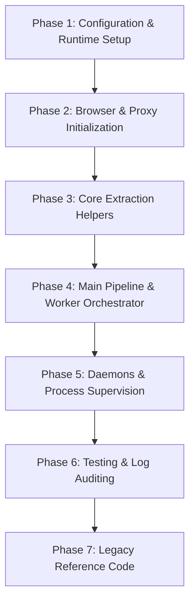

# Learning & Code Review Guide: PowerAdSpy_landers

This guide outlines the recommended reading order, architectural roles, and detailed feature breakdowns for analyzing the **PowerAdSpy_landers** codebase.

---

## 1. Recommended Code Reading Order

To understand how data flows through the system, review the files in this 7-phase sequence:

---

### Phase 1: Configuration & Runtime Environment
Understand the configuration schema, network endpoints, and dependencies before examining execution logic.

1. **[config.yaml](file:///f:/GlobusSoft/PowerAdSpy_landers/config.yaml)**
   - **What to look for**: The `default_settings` block (instance count, dev mode flag, proxy enablement) and the per-network API endpoints (`facebook`, `instagram`, `youtube`, `google`, `gdn`, `native`, `linkedin`, `reddit`, `quora`, `pinterest`). Notice the distinction between `DEV_*` (staging) and `MAIN_*` (production) endpoints.
2. **[config.py](file:///f:/GlobusSoft/PowerAdSpy_landers/config.py)**
   - **What to look for**: The `Config` singleton class, how it parses `config.yaml`, handles fallback paths, normalizes network names, and exposes API URL helper methods.
3. **[requirements.txt](file:///f:/GlobusSoft/PowerAdSpy_landers/requirements.txt)** & **[Dockerfile](file:///f:/GlobusSoft/PowerAdSpy_landers/Dockerfile)**
   - **What to look for**: Python dependencies (`playwright`, `pillow`, `prometheus_client`, `tldextract`, `beautifulsoup4`) and container configuration (Debian base, Chrome Stable, international font packages for CJK/Indic rendering, and Xvfb virtual display setup on `:99`).

---

### Phase 2: Browser Engine & Proxy Routing
Understand how browser instances are spun up, masked, and routed through country proxies.

4. **[helper/init.py](file:///f:/GlobusSoft/PowerAdSpy_landers/helper/init.py)**
   - **What to look for**:
     - `init_dc(iso)`: How Playwright Chromium launches with custom arguments (`--disable-blink-features=AutomationControlled`, `--no-sandbox`).
     - Proxy configuration: Bright Data superproxy authentication (`brd.superproxy.io:44445`) with dynamic country tokens (`-country-{iso}`).
     - Proxy bypass rules: Bypassing Google redirect/SERP domains to prevent tunnel loops.
     - Anti-bot stealth (`STEALTH_JS`): Masks `navigator.webdriver`, mocks `window.chrome`, and fakes plugin/language properties.
     - Egress validation via `lumtest.com` and clean browser teardown (`close_browser`).
5. **[check_proxies.py](file:///f:/GlobusSoft/PowerAdSpy_landers/check_proxies.py)**
   - **What to look for**: Diagnostic script verifying proxy ports (`44445`, `22225`), zone credentials, and geolocation headers.

---

### Phase 3: Core Scraping & Extraction Subsystems
Examine each helper responsible for a specific component of the landing page payload.

6. **[helper/screenshot.py](file:///f:/GlobusSoft/PowerAdSpy_landers/helper/screenshot.py)**
   - **What to look for**:
     - SPA readiness: 10-second wait unblocking Angular/React hydration while continuously dismissing cookie banners (OneTrust, Cookiebot, Usercentrics).
     - Universal animation unfreezing: Evaluates `_UNIVERSAL_ANIMATION_JS` to complete ScrollTrigger, GSAP, AOS, and WOW.js animations so off-screen sections render visibly.
     - Modal & curtain remover: Strips backdrops, login dialogs (Instagram, Spotify), and sticky overlays.
     - Lazy-image eager loader (`_wake_lazy_images`): Replaces `data-src`, `data-srcset` with `src` and polls image load status.
     - Trailing blank void trimmer (`_trim_trailing_blank_void`): Strips excess white/dark space caused by infinite-scroll containers.
     - Progressive compression (`_save_with_size_limit`): Multi-step Pillow JPEG quality downscaling guaranteeing file sizes $< 1.0\text{ MB}$.
7. **[helper/text.py](file:///f:/GlobusSoft/PowerAdSpy_landers/helper/text.py)**
   - **What to look for**: Clean visible text extraction using BeautifulSoup, filtering out `style`, `script`, `head`, and `meta` tags, while recursively appending text from accessible child `iframe` elements.
8. **[helper/html.py](file:///f:/GlobusSoft/PowerAdSpy_landers/helper/html.py)**
   - **What to look for**: DOM extraction with asset localization (downloads up to 40 images, links, scripts) and packages them into `PowerAdSpy.html` and `html.zip`.
9. **[helper/redirect.py](file:///f:/GlobusSoft/PowerAdSpy_landers/helper/redirect.py)**
   - **What to look for**: How `requests.Session` follows 3xx redirection chains and tracks intermediate domains between the initial ad URL and the final destination.
10. **[helper/outgoing_url.py](file:///f:/GlobusSoft/PowerAdSpy_landers/helper/outgoing_url.py)**
    - **What to look for**: Extracts external links from DOM anchor tags, filters out known social networks (Facebook, Instagram, Twitter, Telegram, etc.), and traces redirects for up to 3 external outbound URLs.
11. **[helper/domaindate.py](file:///f:/GlobusSoft/PowerAdSpy_landers/helper/domaindate.py)**
    - **What to look for**: Robust 9-tier fallback architecture for obtaining domain registration dates (PowerAdSpy Domain API $\rightarrow$ python-whois $\rightarrow$ whois.com $\rightarrow$ domaintools.com $\rightarrow$ whoxy.com $\rightarrow$ who.is $\rightarrow$ RDAP $\rightarrow$ WhoisXML API $\rightarrow$ whoisrequest.org).

---

### Phase 4: Main Controller & Concurrency Pipeline
Analyze the central engine tying all modules together into a multi-worker workflow.

12. **[status_3_keywords.txt](file:///f:/GlobusSoft/PowerAdSpy_landers/status_3_keywords.txt)**
    - **What to look for**: Categorized list of dead-page markers (Storefront Unavailable, 404, Access Denied/WAF, Server Errors, Parked/Expired Domains, Auth Walls). Notice that this file auto-reloads on disk without process restart.
13. **[new_lander.py](file:///f:/GlobusSoft/PowerAdSpy_landers/new_lander.py)**
    - **What to look for**:
      - `multi_chrome()`: Multiprocessing pool creation, manager lock, and Prometheus directory initialization.
      - Atomic queue logic: `pop_next_ad_from_file()`, `_shared_queue_path()`, `_atomic_write_json()`.
      - Deduplication & Cooldown: `in_flight_dict` and `completed_dict` with 5-minute cooldown (`AD_COOLDOWN_SECONDS = 300`).
      - Ad redirect pre-resolution: `resolve_ad_redirect()` bypassing SERP loops before launching Playwright.
      - Page status evaluation: `check_page_status()` and `is_login_or_signup_page()`.
      - Scraping workflow: `scraping()` coordinating init $\rightarrow$ navigate $\rightarrow$ screenshot $\rightarrow$ text $\rightarrow$ HTML zip $\rightarrow$ outgoing URLs $\rightarrow$ WHOIS.
      - Payload dispatch: `make_payload()`, S3 upload (`MAIN_S3_API`), and `send_payload()` (`MAIN_INSERT_API`) with fallback column length trimming (`ER_DATA_TOO_LONG`).
      - Error handling & Status 3 dispatch: `send_status3_payload()` notifying backend of blocked/dead pages.

---

### Phase 5: Process Supervision & Maintenance
Understand how long-running production processes are monitored, restarted, and kept clean.

14. **[watcher.py](file:///f:/GlobusSoft/PowerAdSpy_landers/watcher.py)**
    - **What to look for**: Continuous daemon monitoring running Python processes using `psutil`. Restarts `new_lander.py` via `start_process.sh` if it exits.
15. **[restart.py](file:///f:/GlobusSoft/PowerAdSpy_landers/restart.py)**
    - **What to look for**: Idempotent launch utility ensuring only one instance runs, auto-detecting virtual environments on both Windows and Linux.
16. **[kill_old_chrome.py](file:///f:/GlobusSoft/PowerAdSpy_landers/kill_old_chrome.py)** & **[temp_del.py](file:///f:/GlobusSoft/PowerAdSpy_landers/temp_del.py)**
    - **What to look for**: Periodic garbage collection — terminating zombie Chrome processes older than 1 hour and removing orphaned temporary files (`scoped_dir*`).
17. **[start_process.sh](file:///f:/GlobusSoft/PowerAdSpy_landers/start_process.sh)**, **[stop_process.sh](file:///f:/GlobusSoft/PowerAdSpy_landers/stop_process.sh)**, **[start_process.bat](file:///f:/GlobusSoft/PowerAdSpy_landers/start_process.bat)**, **[stop_process.bat](file:///f:/GlobusSoft/PowerAdSpy_landers/stop_process.bat)**
    - **What to look for**: OS-specific execution and graceful termination scripts.

---

### Phase 6: Testing & Log Auditing
Learn how to verify the crawler and analyze output logs.

18. **[test_ad_live.py](file:///f:/GlobusSoft/PowerAdSpy_landers/test_ad_live.py)**
    - **What to look for**: Standalone test harness to crawl a single live ad and verify S3 upload and payload generation without running the full multi-worker pool.
19. **[analysis.py](file:///f:/GlobusSoft/PowerAdSpy_landers/analysis.py)**
    - **What to look for**: Comprehensive CLI auditing script that parses `logs/payloads.log` to evaluate worker load distribution, API response times, S3 format compliance, and status distribution (Status 2 vs Status 3).

---

### Phase 7: Legacy Reference Code (Do Not Modify)
These files provide historical context but are superseded by `new_lander.py`.

20. **[lander_insta_grafana.py](file:///f:/GlobusSoft/PowerAdSpy_landers/lander_insta_grafana.py)** & **[old_lander_insta_grafana.py](file:///f:/GlobusSoft/PowerAdSpy_landers/old_lander_insta_grafana.py)**
    - Older monolithic scripts specifically written for Instagram before the universal multi-network architecture in `new_lander.py`.
21. **[helper/scrape_ad_category.py](file:///f:/GlobusSoft/PowerAdSpy_landers/helper/scrape_ad_category.py)**
    - Legacy BlueCoat categorization module based on Selenium (safely bypassed in `new_lander.py`).

---

## 2. Complete File Directory & Responsibility Catalog

| File / Path | System Layer | Primary Responsibility | Key Features & Implementation Details |
| :--- | :--- | :--- | :--- |
| [config.yaml](file:///f:/GlobusSoft/PowerAdSpy_landers/config.yaml) | Configuration | Application configuration settings | Defines active ad network, worker count, proxy toggles, dev mode flag, and dev/main API endpoint mappings for 10 ad networks. |
| [config.py](file:///f:/GlobusSoft/PowerAdSpy_landers/config.py) | Configuration | Configuration loader & accessor | Parses `config.yaml`, handles fallback paths, normalizes network names, and provides clean getter methods for endpoints and flags. |
| [new_lander.py](file:///f:/GlobusSoft/PowerAdSpy_landers/new_lander.py) | Core Orchestrator | Main controller & multi-worker scraper | Multiprocessing pool manager, atomic shared disk queue, proxy routing, page classification (Status 2 vs 3), S3/Insert API dispatch, and Prometheus metrics. |
| [helper/init.py](file:///f:/GlobusSoft/PowerAdSpy_landers/helper/init.py) | Browser & Network | Playwright engine & proxy stealth | Launches Chromium via Playwright CDP, injects anti-bot stealth JavaScript, configures Bright Data superproxy per country ISO, bypasses Google SERP loops, and validates egress IP. |
| [helper/screenshot.py](file:///f:/GlobusSoft/PowerAdSpy_landers/helper/screenshot.py) | Media Extraction | Full-page screenshot engine | SPA wait & consent dialog dismissal, JS animation unfreezing (ScrollTrigger, GSAP, AOS), lazy image hydration, trailing void trimming, and Pillow JPEG compression $< 1.0\text{ MB}$. |
| [helper/html.py](file:///f:/GlobusSoft/PowerAdSpy_landers/helper/html.py) | Data Archival | DOM & web asset archiver | Extracts rendered DOM via BeautifulSoup, downloads linked assets (images, CSS, JS capped at 40 per type), and compresses them into `html.zip` with `PowerAdSpy.html`. |
| [helper/text.py](file:///f:/GlobusSoft/PowerAdSpy_landers/helper/text.py) | Text Extraction | Visible body text extraction | Parses rendered HTML with BeautifulSoup, strips non-visible tags (`script`, `style`, `meta`), extracts text from child frames/iframes, and normalizes whitespace. |
| [helper/redirect.py](file:///f:/GlobusSoft/PowerAdSpy_landers/helper/redirect.py) | Network Tracing | HTTP redirect chain tracker | Uses `requests.Session` to inspect 3xx HTTP response history, recording all intermediate URLs and cross-domain hops. |
| [helper/outgoing_url.py](file:///f:/GlobusSoft/PowerAdSpy_landers/helper/outgoing_url.py) | Link Discovery | External link extractor | Evaluates DOM anchor tags, filters out internal domain links and social media platforms, capturing up to 3 external destination targets with their redirect chains. |
| [helper/domaindate.py](file:///f:/GlobusSoft/PowerAdSpy_landers/helper/domaindate.py) | Domain Intelligence| Domain registration & age resolver | 9-tier fallback WHOIS strategy querying PowerAdSpy API, Python `whois`, whois.com, domaintools, whoxy, who.is, RDAP, WhoisXML API, and whoisrequest.org. |
| [status_3_keywords.txt](file:///f:/GlobusSoft/PowerAdSpy_landers/status_3_keywords.txt) | Rule Definition | Dead-page & error text phrases | Text markers identifying 404s, store unavailable pages, Cloudflare/WAF challenges, and auth walls. Dynamically reloaded on file modification. |
| [analysis.py](file:///f:/GlobusSoft/PowerAdSpy_landers/analysis.py) | Analytics / Audit | Production log auditor | Parses `logs/payloads.log` to report total throughput, S3 upload compliance, DB insertion latency, worker load balancing, and failure root causes. |
| [test_ad_live.py](file:///f:/GlobusSoft/PowerAdSpy_landers/test_ad_live.py) | Quality Assurance | Single ad live test harness | Executes full scraping pipeline on a single live ad record from `GET_API` to verify browser rendering, uploads, and payload format. |
| [check_proxies.py](file:///f:/GlobusSoft/PowerAdSpy_landers/check_proxies.py) | Diagnostics | Bright Data proxy health checker | Tests connectivity, response times, credentials, and egress IPs across ports `44445` and `22225`. |
| [watcher.py](file:///f:/GlobusSoft/PowerAdSpy_landers/watcher.py) | Process Supervision| Continuous monitoring daemon | Checks every 10 seconds using `psutil` if `new_lander.py` is alive, restarting it automatically via `start_process.sh` if stopped. |
| [restart.py](file:///f:/GlobusSoft/PowerAdSpy_landers/restart.py) | Process Supervision| Idempotent restart utility | Verifies if `new_lander.py` is already executing before spawning a new process with the proper virtualenv interpreter. |
| [kill_old_chrome.py](file:///f:/GlobusSoft/PowerAdSpy_landers/kill_old_chrome.py) | Maintenance | Zombie Chrome process cleaner | Inspects running process creation timestamps and kills Chrome/Chromium processes older than 1 hour. |
| [temp_del.py](file:///f:/GlobusSoft/PowerAdSpy_landers/temp_del.py) | Maintenance | Temporary disk space cleaner | Deletes orphaned Chrome scoped directories and temporary cache files from `/tmp` and system temp directories. |
| [Dockerfile](file:///f:/GlobusSoft/PowerAdSpy_landers/Dockerfile) | Deployment | Container definition | Configures Debian image with Python 3.10, Google Chrome Stable, Xvfb virtual framebuffer on display `:99`, fonts, and exposed ports `8000-8049`. |
| [start_process.sh](file:///f:/GlobusSoft/PowerAdSpy_landers/start_process.sh) | Runner Script | Linux background launch script | Starts Xvfb virtual display if missing, activates `venv`, and runs `new_lander.py` with `nohup`. |
| [stop_process.sh](file:///f:/GlobusSoft/PowerAdSpy_landers/stop_process.sh) | Runner Script | Linux graceful shutdown script | Finds and stops PIDs running `new_lander.py` from this directory using `SIGTERM` followed by `SIGKILL`, then cleans orphaned Chrome instances. |
| [start_process.bat](file:///f:/GlobusSoft/PowerAdSpy_landers/start_process.bat) | Runner Script | Windows launch batch file | Activates local virtualenv and starts `python new_lander.py`. |
| [stop_process.bat](file:///f:/GlobusSoft/PowerAdSpy_landers/stop_process.bat) | Runner Script | Windows termination batch file | Stops `new_lander.py` and child multiprocessing workers via PowerShell CIM queries and terminates `chrome.exe`. |

---

## 3. Data Semantics & Status Codes

When reviewing payloads in logs or database tables, pay attention to the `status` field:
* **`status = 2` (Success)**: Clean, healthy landing page. Full-page screenshot captured, DOM archived, text extracted, and registration date resolved.
* **`status = 3` (Error / Blocked / Gated)**: Unsuccessful landing page due to:
  * HTTP status $\ge 400$ (404 Not Found, 403 Forbidden, 500 Server Error).
  * Anti-bot / WAF challenge (Cloudflare, Incapsula, Datadome, Kasada).
  * Dedicated login or authentication barrier.
  * Empty destination URL or network connection timeout.
  * *Note*: The pipeline submits minimal Status 3 payloads to `INSERT_API` so the backend marks the ad as completed/failed rather than stalling or retrying indefinitely.
